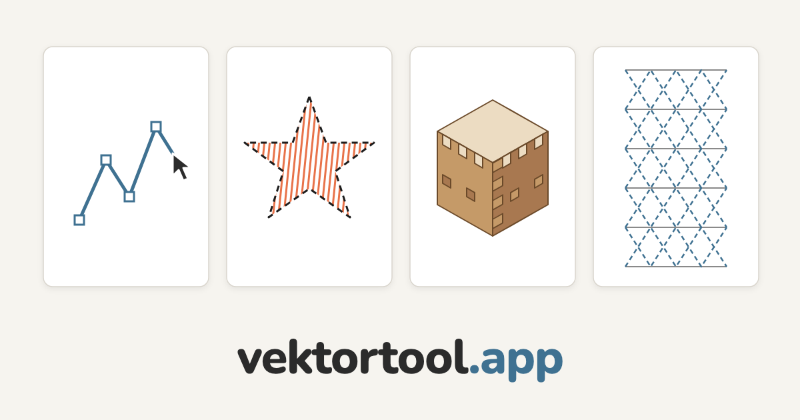

# Vektortool

**From vector to object.** Draw. Embroider. Laser-cut. 3D-print.
Free. No install, no account, works offline. A vector graphics editor that runs
entirely in your browser - a single HTML file, no server.

➡ **[vektortool.app](https://vektortool.app)**

## Release status

The 13 October 2026 release uses the tested `VT-20261012-local-r29` build
(the local identifier is retained so the released application stays byte-identical
to the tested file; SHA-256 `75ccbd71a877bd2fae4f4e9f3d253247d06a7a58d525660142c927c671f76ee5`).
r29 adjusts the tracer interface (colour count on its own line, clearer colour
family option, fill option visible in outline tracing). It builds on r28, which
repaired findings of an independent re-verification of r27: SVG
files with gradient or pattern paint are imported again, import notices name
the actual cause, Gecko no longer stitches path-text characters the browser
does not draw, heavy fills are no longer locked by a 5-second time limit in the
background calculation, late camera streams are stopped, and 59 messages are
translated in all languages. See the changelog for scope and limitations.

The releases were tested in isolated Chrome, Firefox and WebKit profiles with
actual saved browser downloads and independent machine-file decoding. Every
embroidery file that r27 produced in these tests is byte-identical, apart from
the corrected Gecko path-text overflow cases; r29 output is byte-identical to r28. These are targeted repair checks,
not exhaustive browser or machine certification.
Direct paste into the tested macOS Inkscape 1.2.1 remains unsuccessful; selected
artwork can instead be saved with Ctrl/Cmd+Shift+C for SVG file import.

Remaining work includes complex-image and large-text calculation limits, SVG
typography, gradients and `use` references outside the supported subset, broader
device/target-application checks including LightBurn, and physical machine/material
trials. Worker execution improves responsiveness, not total calculation time.
Fine lettering can still contain many short stitches and jumps. Very
small subpaths inside otherwise valid compound objects can still disappear on
the machine grid. There is no manufacturing approval. Existing projects are not
silently cleaned, and previously saved hidden objects are not automatically
unhidden. Back up important work and inspect exports in the intended target
application.
Pushing `main` automatically deploys `vektortool.html` to GitHub Pages.

## What it does

- **Draw** - shapes, paths, freehand, text (also on a path), mirror/repeat, layers
- **Fill** - flood a connected visible colour into a separate vector shape,
  with adjustable tolerance; originals stay unchanged
- **Trace images** - turn a pixel image into vector paths (tracer) plus outline mode
- **Embroider** - stitch types, stitch order, export as an embroidery file (DST/PES)
- **3D printing & laser** - pattern generator (origami and more) and SVG templates
  to extrude in a slicer or cut on a laser cutter
- **Box generator** - finger-joint boxes for laser cutting

Save editable work as **SVG (project)**. It embeds all canvases, hidden objects,
fonts and settings. For sharing visible artwork without this extra project data,
choose **SVG graphic** instead. Existing `.linea` projects can still be imported.

## For school and workshop

Made for school, FabLab and hobby use: **no sign-up, no cloud**, works offline.
All data stays on your device. The interface is available in German and more
than 30 other languages.

## Use it locally

The app is a single file. Open the info panel (ℹ), download the file and open
`vektortool.html` in your browser. It works fully offline, and no data leaves
your device.

## License

[PolyForm Noncommercial 1.0.0](https://polyformproject.org/licenses/noncommercial/1.0.0/)
- free for non-commercial use. © Lukas Jordi.
